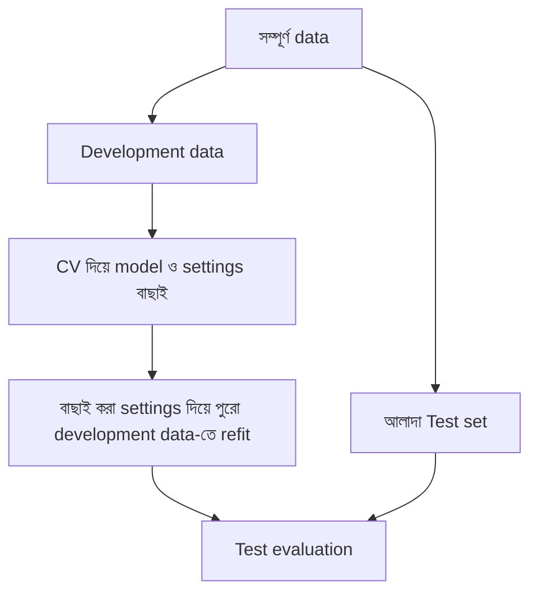
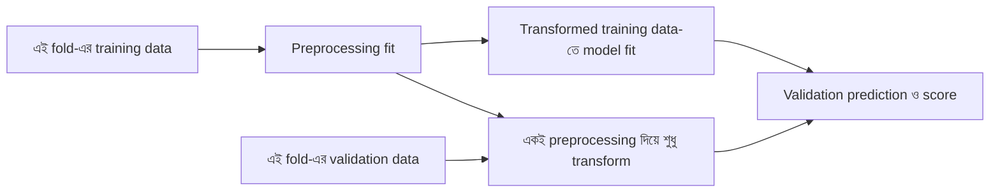

# Cross Validation — সহজ বাংলা রিভিশন নোট

> **মূল ধারণা:** একটি train–validation split-এর ওপর পুরো সিদ্ধান্ত না নিয়ে, একাধিকবার data ভাগ করে model-এর নতুন data-তে কাজ করার ক্ষমতা যাচাই করো।

## 1. Cross Validation কেন দরকার?

একবার data ভাগ করলে validation set ঘটনাক্রমে সহজ বা কঠিন হতে পারে। সেই একটি score দেখে model বাছলে সিদ্ধান্ত split-এর ওপর বেশি নির্ভর করতে পারে। **Cross Validation (CV)** একাধিক training–validation split-এর ফল দেখার একটি পদ্ধতি।

এটি ব্যবহার করা হয়:

- Model বা hyperparameter বাছতে—যেমন polynomial degree, regularization strength বা tree depth।
- নতুন data-তে model কতটা ভালো করতে পারে, তার estimate পেতে।
- বিভিন্ন split-এ score কতটা বদলাচ্ছে বুঝতে।

**CV নিজে কোনো prediction model নয়**, এবং ভালো CV score ভবিষ্যতের সব data-তে একই ফলের নিশ্চয়তা দেয় না।

## 2. Train, Validation ও Test-এর ভূমিকা

| অংশ | কাজ |
| --- | --- |
| Training | Weights, biases বা অন্যান্য model parameters শেখানো |
| Validation / CV folds | Model, hyperparameters ও threshold বাছাই |
| Test | বাছাই শেষ হওয়ার পরে চূড়ান্ত evaluation |

একটি সাধারণ workflow হলো প্রথমে test set আলাদা রাখা, তারপর বাকি **development data**-তে CV চালানো। এখানে development data = training ও model selection-এর জন্য পাওয়া অংশ।



Test set বারবার দেখে settings বদলালে সেটিও model selection-এর অংশ হয়ে যায়; তখন final score আশাবাদী হতে পারে।

## 3. K-fold Cross Validation কীভাবে চলে?

Development data-কে $K$টি আলাদা fold-এ ভাগ করি। প্রতিবার একটি fold validation, বাকি $K-1$টি training। এভাবে $K$টি model fit হয়।

```text
5-fold CV: T = Training, V = Validation

             Fold 1  Fold 2  Fold 3  Fold 4  Fold 5
Round 1:      [ V ]   [ T ]   [ T ]   [ T ]   [ T ]
Round 2:      [ T ]   [ V ]   [ T ]   [ T ]   [ T ]
Round 3:      [ T ]   [ T ]   [ V ]   [ T ]   [ T ]
Round 4:      [ T ]   [ T ]   [ T ]   [ V ]   [ T ]
Round 5:      [ T ]   [ T ]   [ T ]   [ T ]   [ V ]
```

একটি সাধারণ K-fold run-এ প্রতিটি sample **একবার validation** এবং **$K-1$বার training**-এ থাকে। প্রতিটি round-এ model ও preprocessing নতুন করে fit করতে হয়।

সমান fold ধরে, development sample সংখ্যা $N$ হলে:

$$
N_{\text{valid}}=\frac NK,\qquad
N_{\text{train}}=\frac{K-1}{K}N
$$

$N$ যদি $K$ দিয়ে বিভাজ্য না হয়, fold size সামান্য আলাদা হবে। যেমন $N=100$, $K=5$ হলে প্রতিবার ৮০টি sample-এ train, ২০টিতে validate।

## 4. Score-এর গড় ও variation

প্রতি fold-এর score $s_1,\ldots,s_K$ হলে সাধারণ fold average:

$$
\boxed{\bar s=\frac1K\sum_{k=1}^{K}s_k}
$$

এই নোটে fold scores-এর **sample standard deviation** ব্যবহার করছি:

$$
s_{\text{fold}}=\sqrt{\frac1{K-1}\sum_{k=1}^{K}(s_k-\bar s)^2}
$$

কিছু software denominator-এ $K$ দিয়ে standard deviation দেখায়; convention মিলিয়ে নেবে।

**সতর্কতা:** Training folds overlap করে, তাই fold scores স্বাধীন observations নয়। $\bar s\pm s_{\text{fold}}$-কে সরাসরি confidence interval বলা যাবে না।

## 5. হাতে করা 5-fold উদাহরণ

একই metric ও একই folds-এ দুটি candidate-এর accuracy:

| Fold | Model A | Model B |
| --- | ---: | ---: |
| 1 | 0.80 | 0.84 |
| 2 | 0.90 | 0.86 |
| 3 | 0.85 | 0.85 |
| 4 | 0.75 | 0.83 |
| 5 | 0.95 | 0.87 |
| Mean | **0.85** | **0.85** |
| Sample SD | **0.0791** | **0.0158** |

Model A-এর জন্য:

$$
\bar s_A=\frac{0.80+0.90+0.85+0.75+0.95}{5}=0.85
$$

$$
s_A=\sqrt{\frac{0.0025+0.0025+0+0.01+0.01}{4}}
\approx0.0791
$$

দুটির mean সমান হলেও এই run-এ B-এর scores কম বদলেছে। এটি স্থিতিশীলতার একটি ইঙ্গিত; শুধু এই SD দিয়ে B নিশ্চিতভাবে ভালো, এমন সিদ্ধান্ত নেওয়া যায় না। Model complexity, computation এবং class-wise metrics-ও দেখতে হবে।

## 6. কোন CV কখন ব্যবহার করব?

| পদ্ধতি | কী করে? | কখন কাজে লাগে? |
| --- | --- | --- |
| Holdout | একবার train–validation ভাগ | দ্রুত প্রাথমিক তুলনা; এটি বহু-fold CV নয় |
| K-fold | প্রতিটি fold একবার validation | আনুমানিক independent samples-এর সাধারণ evaluation |
| Stratified K-fold | প্রতি fold-এ class proportion কাছাকাছি রাখে | Classification, বিশেষত class imbalance |
| Group K-fold | একই group training ও validation-এ একসঙ্গে রাখে না | একই ব্যক্তি, patient, device বা subject-এর একাধিক sample |
| Time-series split | অতীত দিয়ে train, পরের সময়ে validate | ভবিষ্যৎ predict করার task |
| Leave-One-Out (LOOCV) | প্রতিবার একটি sample validation; $K=N$ | ছোট dataset-এ, computation সম্ভব হলে |
| Repeated K-fold | নতুন partitions দিয়ে K-fold একাধিকবার | Partition বদলালে ফল কতটা বদলায় বোঝা |

Independent data-তে sample order-এর প্রভাব এড়াতে folds তৈরির আগে shuffle উপযোগী হতে পারে। **Time-series data-তে ভবিষ্যৎকে অতীতের training-এ ঢুকিয়ে shuffle করা যাবে না।**

Stratification group leakage বা time leakage ঠিক করে না। Group split করলেও class proportions রাখা যাবে কি না, data অনুযায়ী দেখতে হবে।

## 7. Time-series split-এর চিত্র

```text
সময় ───────────────────────────────────────>

Round 1: [ Train ][Valid][     ভবিষ্যৎ      ]
Round 2: [    Train    ][Valid][  ভবিষ্যৎ  ]
Round 3: [        Train       ][Valid]
```

এটি **expanding window**-এর ধারণা। Rolling window-এ পুরোনো training observations বাদ দিয়ে নির্দিষ্ট সাম্প্রতিক সময় রাখা হয়। Target তৈরির window overlap করলে বা তথ্য পেতে delay থাকলে train–validation-এর মধ্যে gap দরকার হতে পারে।

## 8. Data leakage: preprocessing-ও fold-এর ভেতরে

ধরি, CV করার আগেই পুরো development data দিয়ে mean ও standard deviation বের করে scaling করলে। তখন validation fold-এর তথ্য training transformation-এ ঢুকে গেল।

সঠিক fold-level workflow:



একই নিয়ম প্রযোজ্য:

- Missing-value imputation, scaling ও feature selection।
- Text vocabulary ও data থেকে শেখা transformations।
- PCA এবং training data resampling, যেমন oversampling।

একটি **pipeline**-এ preprocessing ও model একসঙ্গে রাখলে প্রতি fold-এ এই নিয়ম বজায় রাখা সহজ হয়। Validation data-কে training-এর সঙ্গে মিশিয়ে resample করবে না।

## 9. Hyperparameter selection ও refit

যদি ৪টি candidate settings-এর প্রতিটিতে 5-fold CV করি:

$$
\text{CV model fits}=4\times5=20
$$

তারপর বাছাই করা settings দিয়ে পুরো development data-তে **আরেকবার fit** করলে মোট ২১টি fit। এটি শুধু এই সরল search ও একটি final refit-এর হিসাব।

| Metric | বাছাইয়ের সাধারণ দিক |
| --- | --- |
| Accuracy, macro-F1, ROC-AUC | বেশি ভালো |
| Log loss, MAE, RMSE | কম ভালো |

সব candidate-কে একই folds ও metric-এ তুলনা করো। Best fold-এর model নেওয়ার পরিবর্তে সাধারণ workflow-এ **best settings** নিয়ে পুরো development data-তে নতুন model fit করা হয়।

অনেক candidate চেষ্টা করে যে CV score সবচেয়ে বেশি পেলাম, সেটিকে unbiased final performance estimate ধরা ঠিক নয়—selection-এর কারণেও optimism আসতে পারে।

## 10. Nested Cross Validation

একই CV দিয়ে অনেক settings বাছাই এবং সেগুলোর final performance দাবি করার সমস্যা কমাতে **nested CV** ব্যবহার করা যায়।

- **Outer loop:** পুরো model selection procedure-এর evaluation।
- **Inner loop:** শুধু outer-training অংশে hyperparameter selection।

```text
একটি outer round

Development data
├── Outer training
│   └── Inner CV → best settings → outer training-এ refit
└── Outer validation → উপরের fitted model evaluate
```

Outer validation fold-কে inner selection-এ ব্যবহার করা যাবে না। Outer scores-এর গড় পুরো selection procedure-এর generalization estimate দেয়। শেষে deployment-এর জন্য settings selection ও full-data refit আলাদাভাবে করা হয়।

**খরচের উদাহরণ:** ৫ outer folds, ৩ inner folds, ৪ candidates হলে inner fits $5\times3\times4=60$; প্রতিটি outer round-এর refit আরও ৫টি। মোট ৬৫টি fit—শেষের full-development selection/refit এতে ধরা হয়নি।

## 11. Out-of-fold prediction ও CV score এক নয় কেন?

প্রতিটি sample যখন validation fold-এ থাকে, তখন তার জন্য করা prediction সংরক্ষণ করলে **out-of-fold (OOF) predictions** পাওয়া যায়। সাধারণ K-fold-এ প্রতিটি sample-এর prediction এমন model থেকে আসে, যেটি তাকে training-এ দেখেনি।

- OOF predictions দিয়ে diagnostic plots বা pooled metric হিসাব করা যায়।
- Fold metric-এর গড় এবং সব OOF prediction মিলিয়ে metric সাধারণভাবে এক নয়। যেমন F1 ও AUC nonlinear metric।
- সমান fold sizes ও sample-wise additive loss-এর ক্ষেত্রে fold mean ও pooled mean মিলে যায়; অসমান fold হলে weighting গুরুত্বপূর্ণ।
- OOF prediction কোনো একক final fitted model-এর prediction নয়।

## 12. K কত নেব, আর Bias–Variance-এর সম্পর্ক কী?

৫ বা ১০ folds প্রচলিত শুরুর পছন্দ; dataset size, minority class count, groups এবং computation দেখে ঠিক করতে হবে।

- বড় $K$ হলে প্রতি round-এ বেশি data-তে train হয়; training size পুরো development set-এর কাছাকাছি থাকে।
- বড় $K$ হলে fits বেশি লাগে, আর validation folds ছোট হয়।
- LOOCV-তে training sets খুব বেশি overlap করে; বেশি folds মানেই score estimate সবসময় বেশি স্থিতিশীল নয়।
- Split scores-এর variation-কে সরাসরি model-এর bias–variance decomposition-এর variance term বলা যাবে না।

## 13. এক মিনিটের রিভিশন

| প্রশ্ন | উত্তর |
| --- | --- |
| K-fold-এ কয়বার fit? | প্রতি candidate-এ $K$বার |
| প্রতিটি sample validation-এ কতবার? | একটি সাধারণ K-fold run-এ একবার |
| Imbalanced classification? | Stratified split বিবেচনা করো |
| একই ব্যক্তির বহু sample? | Group-aware split |
| Future prediction? | Time-aware split |
| Scaler কোথায় fit? | প্রতিটি fold-এর training অংশে |
| CV-এর পরে? | Settings বেছে full development data-তে refit |
| Nested CV কেন? | Inner selection ও outer evaluation আলাদা রাখতে |
| Fold SD কি confidence interval? | সরাসরি নয়; folds-এর scores independent নয় |

**মনে রাখার লাইন:** **Split → Train → Validate → Repeat → Select → Refit → Test**।

**সম্পর্কিত নোট:** [Evaluation Metrics](../Evaluation%20Metrics/README.md) · [Bias–Variance](../Bias%20Variance/README.md) · [Gradient Descent](../Gradient%20Descent/README.md)
