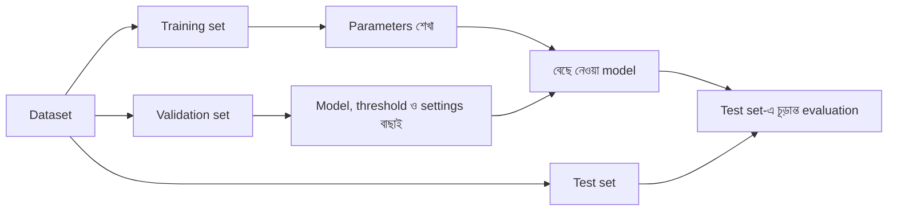

# Evaluation Metrics — সহজ বাংলা রিভিশন নোট

> **মূল ধারণা:** Model ভালো কি না বুঝতে task ও ভুলের ধরনের সঙ্গে মিলিয়ে metric বেছে নাও। শুধু accuracy দেখলে পুরো ছবি বোঝা যায় না।

## 1. Loss, metric ও evaluation data

**Loss** optimization-এর objective-এ ব্যবহার করা হয়। **Metric** model-এর ফল ব্যাখ্যা ও তুলনা করতে সাহায্য করে। একই পরিমাপ, যেমন MSE বা log loss, দুই ভূমিকাতেই থাকতে পারে।



Scaler, imputation ও feature selection শুধু training অংশে fit করতে হবে। Validation/test-এর তথ্য training-এ ঢুকে গেলে **data leakage** হয়। একই ব্যক্তির বারবার data থাকলে group split, আর ভবিষ্যৎ predict করলে time অনুযায়ী split প্রয়োজন হতে পারে।

## 2. Binary classification: confusion matrix

প্রথমে ঠিক করো **কোন class-কে Positive বলছ**। ধরি Spam = Positive।

| Actual ↓ / Predicted → | Positive | Negative |
| --- | ---: | ---: |
| Positive | True Positive (TP) | False Negative (FN) |
| Negative | False Positive (FP) | True Negative (TN) |

- **TP:** Spam-কে Spam বলা।
- **TN:** ভালো ইমেইলকে Not Spam বলা।
- **FP:** ভালো ইমেইলকে Spam বলা — false alarm।
- **FN:** Spam-কে Not Spam বলা — positive sample miss করা।

> **মনে রাখো:** True/False বোঝায় prediction ঠিক কি না; Positive/Negative বোঝায় **predicted class**। Matrix-এর row/column convention বইভেদে উল্টো হতে পারে, তাই labels পড়বে।

## 3. Accuracy ও error rate

মোট sample $N=TP+TN+FP+FN$ হলে:

$$
\boxed{\text{Accuracy}=\frac{TP+TN}{N}},\qquad
\text{Error Rate}=\frac{FP+FN}{N}=1-\text{Accuracy}
$$

**অর্থ:** সব prediction-এর কত অংশ সঠিক?

**Imbalance-এর ফাঁদ:** ১০০০ ইমেইলের মধ্যে ৯৯০টি Not Spam হলে সবগুলোকে Not Spam বলেই accuracy ৯৯% পাওয়া যায়। কিন্তু ১০টি Spam-এর একটিও ধরা হয়নি—Spam recall zero।

## 4. Precision ও Recall: denominator মনে রাখো

$$
\boxed{\text{Precision}=\frac{TP}{TP+FP}}
$$

**Precision:** যাদের positive **বলেছি**, তাদের মধ্যে কতজন সত্যিই positive? FP বাড়লে precision কমে।

$$
\boxed{\text{Recall}=\text{Sensitivity}=\text{TPR}=\frac{TP}{TP+FN}}
$$

**Recall:** যারা আসলেই positive **ছিল**, তাদের কতজনকে ধরতে পেরেছি? FN বাড়লে recall কমে।

```text
Precision-এর দল = Predicted Positive = TP + FP
                 এর মধ্যে সঠিক = TP

Recall-এর দল    = Actual Positive    = TP + FN
                 এর মধ্যে ধরা = TP
```

কোন ভুলের cost বেশি তা দেখে গুরুত্ব ঠিক করো: FP ব্যয়বহুল হলে precision, FN ব্যয়বহুল হলে recall বেশি গুরুত্ব পেতে পারে। একটিকে বাড়াতে গিয়ে অন্যটির কী হচ্ছে, সেটিও দেখতে হবে।

## 5. Specificity, FPR ও balanced accuracy

$$
\text{Specificity}=\text{TNR}=\frac{TN}{TN+FP}
$$

এটি actual negatives-এর কত অংশ ঠিকভাবে negative ধরা হয়েছে, তা মাপে।

$$
\text{FPR}=\frac{FP}{FP+TN}=1-\text{Specificity}
$$

$$
\text{FNR}=\frac{FN}{FN+TP}=1-\text{Recall}
$$

Binary ক্ষেত্রে:

$$
\boxed{\text{Balanced Accuracy}=\frac{\text{Recall}+\text{Specificity}}2}
$$

এতে দুই class-এর recall-কে সমান গুরুত্ব দেওয়া হয়, sample সংখ্যা যতই আলাদা হোক। Multiclass-এ প্রতিটি class-এর recall-এর সাধারণ গড় নেওয়া হয়।

## 6. F1 ও F-beta score

Precision $P$ এবং Recall $R$-এর harmonic mean:

$$
\boxed{F_1=\frac{2PR}{P+R}=\frac{2TP}{2TP+FP+FN}}
$$

একটি খুব কম হলে F1-ও কম হয়। F1 **TN ব্যবহার করে না**, তাই confusion matrix-এর বিকল্প হিসেবে সব তথ্য দেয় না।

$$
F_\beta=(1+\beta^2)\frac{PR}{\beta^2P+R},\qquad \beta>0
$$

- $\beta=1$: Precision ও Recall-এর সমান গুরুত্ব।
- $\beta>1$: Recall-এর ওপর বেশি জোর।
- $0<\beta<1$: Precision-এর ওপর বেশি জোর।

যেকোনো ratio-তে denominator zero হলে metric undefined হতে পারে। কোন reporting convention ব্যবহার করছ—যেমন zero বা undefined দেখানো—সেটি স্পষ্ট রাখবে।

## 7. হাতে করা confusion matrix-এর উদাহরণ

| Actual ↓ / Predicted → | Positive | Negative | মোট |
| --- | ---: | ---: | ---: |
| Positive | 40 | 10 | 50 |
| Negative | 20 | 130 | 150 |
| মোট | 60 | 140 | 200 |

এখানে $TP=40$, $FN=10$, $FP=20$, $TN=130$।

| Metric | হিসাব | ফল |
| --- | --- | ---: |
| Accuracy | $(40+130)/200$ | 0.85 |
| Precision | $40/(40+20)$ | 0.6667 |
| Recall | $40/(40+10)$ | 0.80 |
| Specificity | $130/(130+20)$ | 0.8667 |
| FPR | $20/150$ | 0.1333 |
| F1 | $80/(80+20+10)$ | 0.7273 |
| Balanced Accuracy | $(0.8+0.8667)/2$ | 0.8333 |

**ব্যাখ্যা:** ৮৫% prediction ঠিক হলেও positive বলা sample-এর প্রায় এক-তৃতীয়াংশ false alarm। একটি metric দিয়ে এই পার্থক্য বোঝা যায় না।

## 8. Threshold বদলালে কী হয়?

Probability $p$ এবং threshold $\tau$ হলে:

$$
\hat y=\begin{cases}1,&p\ge\tau\\0,&p<\tau\end{cases}
$$

একই scores রেখে threshold কমালে বেশি sample positive হয়। তাই recall কমে না, কিন্তু FP বাড়তে পারে। Precision কী হবে তা data ও scores-এর ওপর নির্ভর করে; সব ক্ষেত্রে একদিকে বদলায় না।

```text
Sample-এর predicted positive probability

0 ────── 0.2 ────── 0.5 ────── 0.8 ────── 1
           ↑           ↑
        কম threshold  বেশি threshold

Threshold থেকে ডান দিকের sample-গুলো Positive
```

Threshold validation data দিয়ে বাছবে; test ফল দেখে বারবার threshold বদলাবে না।

## 9. ROC-AUC এবং Precision–Recall curve

**ROC curve:** বিভিন্ন threshold-এ **x-axis = FPR**, **y-axis = TPR/Recall**।

```text
TPR
1 |      _________●
  |    /
  |  /
  | /
0 ●-----------------> FPR
  0                  1
       উদাহরণমূলক ROC
```

**ROC-AUC** হলো ROC curve-এর নিচের area। Binary ক্ষেত্রে এর ranking অর্থ:

$$
\text{AUC}=P(s_+>s_-)+\frac12P(s_+=s_-)
$$

অর্থাৎ random positive-negative pair-এ positive-কে বেশি score দেওয়ার সম্ভাবনা, tie-এ অর্ধেক credit। Perfect ranking-এ AUC 1; random ranking-এর expected AUC 0.5। দুই class-ই evaluation data-তে থাকতে হবে।

**ছোট উদাহরণ:** Positive scores $[0.9,0.6]$, negative scores $[0.7,0.2]$। চারটি pair-এর মধ্যে positive তিনটিতে জেতে, তাই AUC $3/4=0.75$।

**PR curve:** x-axis = Recall, y-axis = Precision। Positive class বিরল হলে positive predictions-এর মান বুঝতে এটি বিশেষভাবে উপযোগী। Class prevalence বদলালে precision ও PR ফলও বদলাতে পারে।

**Average Precision (AP)**-এর একটি প্রচলিত সংজ্ঞা:

$$
\text{AP}=\sum_n(R_n-R_{n-1})P_n
$$

এখানে recall বৃদ্ধির পরিমাণ দিয়ে precision-কে weight করা হয়। AP ও trapezoidal PR-AUC-এর হিসাব এক নয়; রিপোর্টে কোনটি ব্যবহার করছ স্পষ্ট করো। ROC-AUC probability calibration মাপে না—ভালো ranking থাকলেও probabilities যথাযথ নাও হতে পারে।

## 10. Probability-এর মান: Log Loss ও Brier Score

Binary log loss:

$$
\text{Log Loss}=-\frac1N\sum_{i=1}^{N}\left[y_i\log p_i+(1-y_i)\log(1-p_i)\right]
$$

**কম ভালো।** ভুল prediction-এ অতিরিক্ত confidence থাকলে penalty বেশি। যেমন সত্য label 1 হলে $p=0.9$-এ loss প্রায় 0.1053, আর $p=0.1$-এ 2.3026। সত্য class-কে zero probability দিলে গাণিতিক loss অসীম; বাস্তব implementation-এ stable computation লাগে।

Binary Brier score-এর convention:

$$
\text{Brier}=\frac1N\sum_{i=1}^{N}(p_i-y_i)^2
$$

এটিও **কম ভালো**। একটি probability model-এর সামগ্রিক মান বিচার করে; এটি শুধু calibration-এর আলাদা পরিমাপ নয়।

## 11. Multiclass: Macro, Micro ও Weighted average

প্রতিটি class-কে একবার positive, বাকি সবকে negative ধরে class-wise precision, recall ও F1 বের করা যায়। Class $k$-এর actual sample সংখ্যা $n_k$ হলো তার **support**।

| Average | কীভাবে হিসাব | কাকে গুরুত্ব দেয়? |
| --- | --- | --- |
| Macro | Class-wise metric-এর সাধারণ গড় | প্রতিটি class সমান |
| Weighted | Support দিয়ে weighted average | বড় class-এর প্রভাব বেশি |
| Micro | আগে সব class-এর TP, FP, FN যোগ; পরে metric | Sample-level মোট ফল |

$$
F_{1,\text{macro}}=\frac1K\sum_{k=1}^{K}F_{1,k},\qquad
F_{1,\text{weighted}}=\sum_{k=1}^{K}\frac{n_k}{N}F_{1,k}
$$

**Macro-F1 = class-wise F1-এর গড়**; macro precision ও macro recall-এর harmonic mean সাধারণভাবে macro-F1 নয়।

সব class অন্তর্ভুক্ত থাকা **single-label multiclass** task-এ micro precision = micro recall = micro F1 = accuracy। Multilabel বা কিছু class বাদ দেওয়া evaluation-এ এই সমতা সাধারণভাবে প্রযোজ্য নয়।

Multiclass log loss, one-hot target $y_{ik}$-এর জন্য:

$$
-\frac1N\sum_{i=1}^{N}\sum_{k=1}^{K}y_{ik}\log p_{ik}
$$

## 12. Regression: MAE, MSE ও RMSE

এবার target হলো সংখ্যা। $e_i=y_i-\hat y_i$ ধরে:

$$
\boxed{\text{MAE}=\frac1N\sum_i|e_i|}
$$

$$
\boxed{\text{MSE}=\frac1N\sum_i e_i^2},\qquad
\boxed{\text{RMSE}=\sqrt{\text{MSE}}}
$$

| Metric | Unit | বৈশিষ্ট্য |
| --- | --- | --- |
| MAE | Target-এর unit | Absolute error; বড় error-এর প্রভাব linear |
| MSE | Target unit-এর square | বড় error-কে বেশি penalty দেয় |
| RMSE | Target-এর unit | Squared error-ভিত্তিক; বড় error-এ সংবেদনশীল |

সবগুলোতেই **কম ভালো**। RMSE হলো **গড় squared error-এর square root**, absolute error-এর গড় নয়।

## 13. R-squared ও MAPE

$$
\boxed{R^2=1-\frac{\sum_i(y_i-\hat y_i)^2}{\sum_i(y_i-\bar y)^2}}
$$

এখানে $\bar y$ হলো **এই evaluation set-এর** target mean।

- $R^2=1$: Perfect predictions, যদি denominator nonzero হয়।
- $R^2=0$: Evaluation mean-কে সব sample-এর prediction ধরলে যে squared error হতো, তার সমান।
- $R^2<0$: সেই constant baseline-এর চেয়েও খারাপ squared error।
- সব $y_i$ সমান হলে denominator zero; এই সূত্র undefined।

> **R² accuracy percentage নয়**, এবং এটি negative-ও হতে পারে।

যখন সব actual value nonzero, percentage error-এর একটি metric:

$$
\text{MAPE}=\frac{100\%}{N}\sum_i\left|\frac{y_i-\hat y_i}{y_i}\right|
$$

Actual zero হলে এটি undefined; near-zero actual থাকলে খুব বড় হতে পারে। তাই সব regression task-এ উপযুক্ত নয়।

## 14. হাতে করা regression উদাহরণ

Actual $y=[2,4,6]$, prediction $\hat y=[3,4,5]$।

| Sample | Actual | Prediction | Error $y-\hat y$ | Absolute error | Squared error |
| --- | ---: | ---: | ---: | ---: | ---: |
| 1 | 2 | 3 | −1 | 1 | 1 |
| 2 | 4 | 4 | 0 | 0 | 0 |
| 3 | 6 | 5 | 1 | 1 | 1 |

$$
\text{MAE}=\frac23\approx0.6667,\qquad
\text{MSE}=\frac23\approx0.6667,\qquad
\text{RMSE}=\sqrt{\frac23}\approx0.8165
$$

এখানে $\bar y=4$, তাই:

$$
R^2=1-\frac{2}{(2-4)^2+(4-4)^2+(6-4)^2}
=1-\frac28=0.75
$$

এটি ৭৫% sample সঠিক বলছে না; mean baseline-এর তুলনায় squared error কতটা কমেছে তা বোঝাচ্ছে।

## 15. Cross-validation ও metric বাছাই

**K-fold cross-validation:** Data-কে $K$ ভাগ করো; প্রতিবার $K-1$ ভাগে train এবং বাকি ভাগে validate করো। এখানে $K$ হলো fold সংখ্যা, class সংখ্যা নয়।

```text
চার fold-এর উদাহরণ: T = Train, V = Validate

Round 1: [V] [T] [T] [T]
Round 2: [T] [V] [T] [T]
Round 3: [T] [T] [V] [T]
Round 4: [T] [T] [T] [V]
```

প্রতি fold-এর training অংশেই preprocessing fit করতে হবে। Fold scores-এর গড় ও variation দেখো। Classification-এ stratification class proportion রাখতে সাহায্য করে; time/group data-তে উপযুক্ত split দরকার। চূড়ান্ত test set-কে tuning-এর বাইরে রাখো।

| লক্ষ্য | কী দেখতে পারো? |
| --- | --- |
| মোট সঠিক prediction | Accuracy, confusion matrix |
| Positive miss কমানো | Recall এবং FP-এর প্রভাব |
| False alarm কমানো | Precision এবং recall |
| Class imbalance | Class-wise scores, macro-F1, balanced accuracy, PR curve |
| Score-এর ranking | ROC-AUC, AP/PR curve |
| Probability-এর মান | Log loss, Brier ও calibration বিশ্লেষণ |
| Typical numeric error | MAE |
| বড় numeric error-কে বেশি গুরুত্ব | RMSE/MSE |
| Mean baseline-এর তুলনা | R² |

## 16. এক মিনিটের রিভিশন

| প্রশ্ন | উত্তর |
| --- | --- |
| Precision-এর denominator? | Predicted positives: TP + FP |
| Recall-এর denominator? | Actual positives: TP + FN |
| ROC axes? | x = FPR, y = TPR |
| PR axes? | x = Recall, y = Precision |
| Macro-F1? | প্রতি class-এর F1-এর সাধারণ গড় |
| Accuracy কখন বিভ্রান্ত করতে পারে? | Class imbalance ও অসম ভুলের cost থাকলে |
| কম ভালো? | Log loss, Brier, MAE, MSE, RMSE |
| R² negative হতে পারে? | হ্যাঁ; evaluation mean baseline-এর চেয়েও খারাপ হলে |
| Threshold কোথায় বাছব? | Validation data-তে |

**সম্পর্কিত নোট:** [Logistic Regression](../Logistic%20Regression/README.md) · [Multinomial Regression](../Multinomial%20Regression/README.md) · [Gradient Descent](../Gradient%20Descent/README.md) · [Cross Validation](../Cross%20Validation/README.md) · [Bias–Variance](../Bias%20Variance/README.md)
