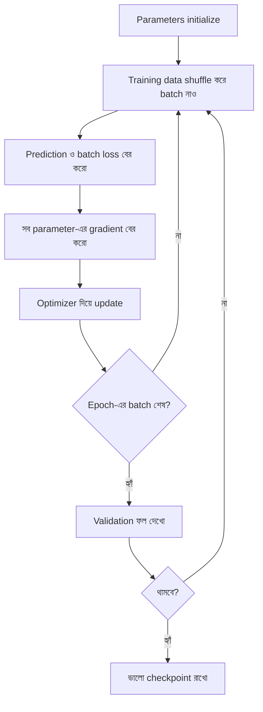

# Gradient Descent — সহজ বাংলা রিভিশন নোট

> **মূল ধারণা:** Loss কোন দিকে বাড়ছে তা gradient বলে। তার বিপরীত দিকে ছোট ছোট step নিয়ে model-এর parameters আপডেট করি।

## 1. কী শেখাই, আর কী কমাই?

একটি model-এর weights ও biases একসঙ্গে $\theta$ দিয়ে বোঝাই। Training-এর লক্ষ্য এমন $\theta$ খোঁজা যাতে cost বা objective $J(\theta)$ ছোট হয়।

$$
\boxed{\theta^*=\arg\min_\theta J(\theta)}
$$

**Gradient Descent (GD)** এই minimization করার একটি iterative optimization পদ্ধতি। এটি Linear Regression, Logistic Regression, Neural Network ইত্যাদি model train করতে ব্যবহার করা যায়।

| শব্দ | সহজ অর্থ |
| --- | --- |
| Parameter | Data থেকে শেখা weight, bias ইত্যাদি |
| Hyperparameter | Learning rate, batch size ইত্যাদি; training-এর settings |
| Loss $\ell$ | একটি sample-এর ভুলের পরিমাপ |
| Cost $J$ | সাধারণত sample-গুলোর গড় loss, প্রয়োজনে penalty-সহ |
| Gradient $\nabla J$ | প্রতিটি parameter-এর সাপেক্ষে partial derivative-এর vector |

## 2. Derivative থেকে gradient

একটি parameter $w$ হলে derivative $dJ/dw$ বলে, $w$ সামান্য বাড়ালে $J$ কোন দিকে কত দ্রুত বদলাবে। অনেক parameter হলে:

$$
\nabla_\theta J=
\begin{bmatrix}
\partial J/\partial\theta_1\\
\partial J/\partial\theta_2\\
\vdots\\
\partial J/\partial\theta_d
\end{bmatrix}
$$

Euclidean দূরত্বের হিসাবে gradient স্থানীয়ভাবে সবচেয়ে দ্রুত **বাড়ার দিক** নির্দেশ করে। তাই কমানোর update:

$$
\boxed{\theta_{t+1}=\theta_t-\eta_t\nabla J(\theta_t)}
$$

এখানে $t$ = update index এবং $\eta_t>0$ = learning rate।

```text
একটি bowl-shaped loss curve

 J(w)
  ^
  |  ●                   ●
  |   ↘                 ↙
  |     ●             ●
  |       ↘         ↙
  |          ●___●
  +----------------------------> w
                 minimum
```

- Gradient **positive** হলে $w$ কমে।
- Gradient **negative** হলে $w$ বাড়ে।
- Gradient **zero** হলে এই update-এ পরিবর্তন নেই; তবে সেটি minimum, maximum অথবা saddle point-ও হতে পারে।

## 3. বিয়োগ করলে loss কমার ধারণা কোথা থেকে আসে?

ছোট একটি parameter পরিবর্তন $\Delta\theta$-এর জন্য first-order approximation:

$$
J(\theta+\Delta\theta)\approx J(\theta)+\nabla J(\theta)^T\Delta\theta
$$

এখন $\Delta\theta=-\eta\nabla J(\theta)$ বসালে:

$$
J(\theta-\eta\nabla J)\approx J(\theta)-\eta\|\nabla J\|_2^2
$$

Gradient nonzero হলে ডান পাশের correction negative। এই যুক্তি **যথেষ্ট ছোট step-এর স্থানীয় ধারণা** দেয়; অনেক বড় learning rate-এ approximation ভালো নাও হতে পারে।

## 4. হাতে করা সহজ উদাহরণ

ধরি:

$$
J(w)=(w-3)^2,\qquad \frac{dJ}{dw}=2(w-3)
$$

শুরু করি $w_0=0$ এবং $\eta=0.1$ দিয়ে।

| Step $t$ | বর্তমান $w_t$ | Gradient $2(w_t-3)$ | পরের $w_{t+1}$ | পরের loss |
| ---: | ---: | ---: | ---: | ---: |
| 0 | 0 | −6 | $0-0.1(-6)=0.6$ | 5.76 |
| 1 | 0.6 | −4.8 | 1.08 | 3.6864 |
| 2 | 1.08 | −3.84 | 1.464 | 2.359296 |

শুরুর loss $9$ ছিল। Updates-এর ফলে $w$ ধীরে ধীরে optimum $3$-এর দিকে যাচ্ছে।

এই নির্দিষ্ট quadratic-এর জন্য:

$$
w_{t+1}-3=(1-2\eta)(w_t-3)
$$

তাই constant learning rate-এ error ছোট হবে যদি $|1-2\eta|<1$, অর্থাৎ $0<\eta<1$। **এই range শুধু এই উদাহরণের জন্য**, সব model-এর জন্য নয়। যেমন $\eta=1.1$ হলে শুরুতেই $w_1=6.6$ এবং loss $12.96$—আগের চেয়েও বেশি।

## 5. Linear Regression-এর gradient বের করা

$m$টি training sample-এর জন্য:

$$
\hat y_i=wx_i+b,\qquad
J(w,b)=\frac{1}{2m}\sum_{i=1}^{m}(wx_i+b-y_i)^2
$$

এখানে $1/2$ রাখা হয়েছে derivative-এর 2 cancel করার জন্য। Chain rule দিয়ে:

$$
\boxed{\frac{\partial J}{\partial w}
=\frac1m\sum_{i=1}^{m}(\hat y_i-y_i)x_i}
$$

$$
\boxed{\frac{\partial J}{\partial b}
=\frac1m\sum_{i=1}^{m}(\hat y_i-y_i)}
$$

তারপর একই পুরোনো parameters থেকে বের করা gradients দিয়ে:

$$
w\leftarrow w-\eta\frac{\partial J}{\partial w},\qquad
b\leftarrow b-\eta\frac{\partial J}{\partial b}
$$

**সংখ্যায় দেখি:** Data $(x,y)=(1,2),(2,4)$; শুরুতে $w=b=0$। Predictions $(0,0)$ এবং errors $(-2,-4)$। তাই:

$$
\frac{\partial J}{\partial w}=\frac{-2(1)-4(2)}2=-5,\qquad
\frac{\partial J}{\partial b}=\frac{-2-4}2=-3
$$

$\eta=0.1$ হলে $w_{\text{new}}=0.5$, $b_{\text{new}}=0.3$। নতুন predictions $(0.8,1.3)$; cost **5 থেকে 2.1825** হয়।

## 6. Batch, Stochastic ও Mini-batch GD

একটি batch $\mathcal B$-তে $B$টি sample থাকলে gradient estimate:

$$
g_t=\frac1B\sum_{i\in\mathcal B}\nabla_\theta\ell_i(\theta_t)
$$

| ধরন | প্রতি update-এ data | বৈশিষ্ট্য |
| --- | --- | --- |
| Batch / Full-batch GD | সব $m$টি sample | পুরো training objective-এর exact gradient; বড় dataset-এ প্রতি step ব্যয়বহুল |
| Stochastic GD, এক-sample অর্থে | একটি sample | Update সস্তা, কিন্তু gradient অনেক ওঠানামা করে |
| Mini-batch GD | $1<B<m$টি sample | Gradient noise ও computation-এর মধ্যে সমন্বয় |

অনেক সময় “SGD” শব্দটি mini-batch update বোঝাতেও ব্যবহার করা হয়; context খেয়াল করতে হবে।

**Epoch** = পুরো training data একবার ব্যবহার। **Iteration/step** = একবার parameter update। শেষের ছোট batch রাখলে প্রতি epoch-এ $\lceil m/B\rceil$টি update। যেমন $m=1000$, $B=100$ হলে ১০টি।



## 7. Learning rate, scaling ও convergence

| পরিস্থিতি | কী হতে পারে / কী করা যায় |
| --- | --- |
| Learning rate খুব ছোট | Loss ধীরে কমে |
| খুব বড় | Overshoot, oscillation বা divergence হতে পারে |
| Feature-এর scale অনেক আলাদা | Loss surface সরু উপত্যকার মতো হতে পারে; updates zigzag করতে পারে |
| Standardization | Training mean ও standard deviation দিয়ে $x_j'=(x_j-\mu_j)/s_j$ |
| Learning rate decay | Training-এর পরে ছোট steps নিতে $\eta_t$ কমানো |
| Noisy mini-batch loss | প্রতিটি step-এ কমবে এমন প্রত্যাশা করো না; epoch average ও validation trend দেখো |

Constant feature-এর $s_j=0$ হলে আলাদাভাবে handle করতে হবে। Scaler **শুধু training data-তে fit** করো, তারপর validation/test-এ একই transformation প্রয়োগ করো।

একটি সহজ schedule:

$$
\eta_t=\frac{\eta_0}{1+kt},\qquad k\ge0
$$

উপযুক্ত assumptions ও learning rate-এ convex objective-এর global minimum-এর দিকে convergence পাওয়া যায়। Neural Network-এর nonconvex objective-এ global optimum পাওয়ার সাধারণ নিশ্চয়তা নেই।

## 8. Momentum: আগের দিকের তথ্য রাখা

এই নোটে momentum-এর convention:

$$
v_t=\beta v_{t-1}+g_t,\qquad
\theta_t=\theta_{t-1}-\eta v_t
$$

এখানে $v_0=0$, $0\le\beta<1$। একই দিকে gradients এলে velocity জমে; দিক পাল্টাতে থাকলে কিছুটা cancel হয়। ফলে কিছু সমস্যায় zigzag কমে ও শেখা দ্রুত হয়।

কিছু বইয়ে $g_t$-এর আগে $(1-\beta)$ থাকে; সেটি অন্য scaling convention। সূত্র মেশালে step size বদলে যায়।

## 9. AdaGrad, RMSProp ও Adam

সব parameter-এর জন্য একই effective step size উপযুক্ত নাও হতে পারে। Adaptive optimizers gradient history দিয়ে প্রতি parameter-এর step scale বদলায়। নিচের square, square root ও ভাগ **element-wise**।

### AdaGrad

$$
s_t=s_{t-1}+g_t^2,\qquad
\theta_t=\theta_{t-1}-\eta\frac{g_t}{\sqrt{s_t}+\epsilon}
$$

পুরোনো squared gradients জমতে থাকে। কম update পাওয়া features-এ সাহায্য করতে পারে; দীর্ঘ training-এ effective learning rate খুব ছোট হয়ে যেতে পারে।

### RMSProp — একটি প্রচলিত রূপ

$$
s_t=\rho s_{t-1}+(1-\rho)g_t^2,\qquad
\theta_t=\theta_{t-1}-\eta\frac{g_t}{\sqrt{s_t}+\epsilon}
$$

পুরো history যোগ করার বদলে exponentially weighted average রাখে।

### Adam — first ও second moment একসঙ্গে

$$
m_t=\beta_1m_{t-1}+(1-\beta_1)g_t
$$

$$
v_t=\beta_2v_{t-1}+(1-\beta_2)g_t^2
$$

শুরুতে $m_0=v_0=0$ ধরলে bias correction:

$$
\hat m_t=\frac{m_t}{1-\beta_1^t},\qquad
\hat v_t=\frac{v_t}{1-\beta_2^t}
$$

$$
\boxed{\theta_t=\theta_{t-1}-\eta\frac{\hat m_t}{\sqrt{\hat v_t}+\epsilon}}
$$

এখানে $t$ শুরু 1 থেকে; $\epsilon>0$ denominator-এ numerical stability দেয়। Adam-এও learning rate নির্বাচন দরকার; এটি সব সমস্যায় সেরা ফলের নিশ্চয়তা দেয় না।

## 10. Regularization, stopping ও gradient check

**L2 penalty:** যদি $J=J_{\text{data}}+(\lambda/2)\|w\|_2^2$ হয়, তাহলে:

$$
\nabla_w J=\nabla_w J_{\text{data}}+\lambda w
$$

Bias-এর ওপর penalty আছে কি না তা objective-এ স্পষ্ট করতে হবে।

**কখন থামব?** Maximum epoch, gradient norm ছোট হওয়া, loss-এর পরিবর্তন ছোট হওয়া অথবা validation-based early stopping ব্যবহার করা যায়। ছোট gradient পেলেই ভালো generalization বা global minimum নিশ্চিত হয় না।

**Gradient check:** Smooth বিন্দুতে হাতে/কোডে বের করা derivative যাচাই করতে central difference:

$$
\frac{\partial J}{\partial\theta_j}\approx
\frac{J(\theta+\varepsilon e_j)-J(\theta-\varepsilon e_j)}{2\varepsilon}
$$

এখানে $e_j$ শুধু $j$-তম parameter পরিবর্তন করে। এটি debugging-এর জন্য; সব parameter-এ numerical gradient দিয়ে বড় model train করা ব্যয়বহুল।

## 11. সাধারণ ভুল ও এক মিনিটের রিভিশন

- Gradient **বিয়োগ** করতে হবে; যোগ করলে gradient ascent হয়।
- Mean loss হলে batch gradient-ও mean করো।
- একই step-এর সব gradients বের করে তারপর parameters আপডেট করো।
- Neural Network-এ **backpropagation gradients বের করে**, optimizer আপডেট করে।
- Mini-batch loss-এর সামান্য ওঠানামাকে একাই failure ধরো না।
- Initialization, feature scale ও learning rate-ও ফলকে প্রভাবিত করে।

| বিষয় | মনে রাখার সূত্র / কথা |
| --- | --- |
| মূল update | $\theta\leftarrow\theta-\eta\nabla J$ |
| Linear Regression gradient | Error × input-এর গড়; bias-এর জন্য error-এর গড় |
| Full-batch / SGD / Mini-batch | সব sample / একটি / ছোট দল |
| Momentum | Gradient-এর আগের দিকের তথ্য রাখে |
| Adam | First moment + squared gradient moment + bias correction |
| Epoch | Dataset একবার ব্যবহার |
| Convergence | Objective ও step size-এর assumptions-এর ওপর নির্ভরশীল |

**সম্পর্কিত নোট:** [Linear Regression](../Linear%20Regression/README.md) · [Neural Network](../Neural%20Network/README.md) · [Multinomial Regression](../Multinomial%20Regression/README.md) · [Evaluation Metrics](../Evaluation%20Metrics/README.md)
