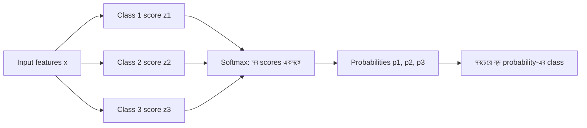

# Multinomial Logistic Regression — সহজ বাংলা রিভিশন নোট

> **মূল ধারণা:** প্রতিটি class-এর জন্য একটি linear score বের করো → softmax দিয়ে probabilities বানাও → সবচেয়ে বেশি probability-এর class বেছে নাও।

## 1. Multinomial Regression বলতে এখানে কী বোঝাচ্ছি?

এই নোটে **Multinomial Logistic Regression**, অর্থাৎ **Softmax Regression** আলোচনা করা হয়েছে। এটি binary logistic regression-এর multiclass extension। Target-এর একাধিক সম্ভাব্য class থাকে, আর প্রতিটি sample-এর **একটিমাত্র class সঠিক**।

উদাহরণ: একটি review-এর sentiment **Positive / Neutral / Negative**, অথবা একটি ছবির class **Cat / Dog / Bird**। Class-গুলোর স্বাভাবিক order থাকা এখানে প্রয়োজন নেই।

| কাছাকাছি নাম | কাজ / পার্থক্য |
| --- | --- |
| Binary Logistic Regression | দুটি class; sigmoid দিয়ে probability |
| Multinomial Logistic Regression | একাধিক mutually exclusive class; softmax |
| Multiple Linear Regression | একাধিক input feature দিয়ে numeric target predict করা |
| Polynomial Regression | $x^2,x^3$ ইত্যাদি polynomial features দিয়ে numeric target model করা |
| Multinomial Naive Bayes | Count features-এর probabilistic classifier; conditional independence assumption ব্যবহার করে |

> **নামের ফাঁদ:** Multinomial logistic regression নাম হলেও task হলো **classification**। এখানে target কোনো continuous number নয়।

## 2. Model-এর চিত্র



এখানে আলাদা hidden layer নেই। এটি সরাসরি features থেকে class scores বের করে। Neural Network-এর শেষ layer-এও softmax ব্যবহার করা যায়, তবে সেখানে আগের layers nonlinear representation শিখতে পারে।

## 3. প্রতিটি class-এর linear score বা logit

ধরি $d$টি input feature এবং $K$টি class আছে। Class $k$-এর জন্য:

$$
\boxed{z_k=w_k^Tx+b_k=\sum_{j=1}^{d}w_{kj}x_j+b_k}
$$

সব class একসঙ্গে লিখলে:

$$
z=Wx+b
$$

| পরিমাণ | Shape |
| --- | --- |
| Input $x$ | $d\times1$ |
| Weights $W$ | $K\times d$ |
| Bias $b$ | $K\times1$ |
| Scores $z$, probabilities $p$ | $K\times1$ |

Logit positive বা negative যেকোনো real number হতে পারে। **Logit নিজে probability নয়।**

## 4. Softmax: scores থেকে probabilities

$$
\boxed{p_k=P(Y=k\mid x)=\frac{e^{z_k}}{\sum_{j=1}^{K}e^{z_j}}}
$$

Finite logits হলে:

$$
0<p_k<1,\qquad \sum_{k=1}^{K}p_k=1
$$

এক class-এর probability বাড়াতে অন্যগুলোর অংশ কমতে হয়। তাই mutually exclusive classes-এর জন্য এটি উপযোগী।

### হাতে করা softmax

ধরি $z=[2,1,0]^T$। তাহলে $e^z\approx[7.389,2.718,1]^T$ এবং যোগফল প্রায় 11.107।

$$
p\approx\begin{bmatrix}0.6652\\0.2447\\0.0900\end{bmatrix}
$$

```text
Class 1   █████████████       66.52%
Class 2   █████               24.47%
Class 3   ██                   9.00%
```

Rounding-এর কারণে প্রদর্শিত percentages-এর যোগফল সামান্য এদিক-ওদিক হতে পারে। Prediction হলো **Class 1**।

$$
\boxed{\hat y=\arg\max_k p_k=\arg\max_k z_k}
$$

Softmax scores-এর ক্রম বদলায় না। শুধু class label দরকার হলে logits-এর argmax-ই যথেষ্ট।

## 5. Numerical stability: বড় exponent এড়ানো

$e^{1000}$ সরাসরি হিসাব করলে overflow হতে পারে। সব logit থেকে একই constant বাদ দিলে softmax বদলায় না। তাই $M=\max_j z_j$ নিয়ে:

$$
\boxed{p_k=\frac{e^{z_k-M}}{\sum_j e^{z_j-M}}}
$$

উদাহরণে $[2,1,0]$-এর বদলে $[0,-1,-2]$ ব্যবহার করলেও একই probabilities পাওয়া যায়।

Cross-entropy সরাসরি logits থেকে স্থিতিশীলভাবে হিসাব করা যায়:

$$
\ell=-z_c+\log\sum_j e^{z_j}
=-(z_c-M)+\log\sum_j e^{z_j-M}
$$

এখানে $c$ হলো সত্য class। এতে খুব ছোট probability আগে তৈরি করে পরে log নেওয়ার প্রয়োজন কমে।

## 6. One-hot label ও Cross-Entropy loss

তিনটি class-এর মধ্যে সত্য class 2 হলে:

$$
y=\begin{bmatrix}0\\1\\0\end{bmatrix}
$$

এটিই **one-hot encoding**: সঠিক class-এর অবস্থানে 1, অন্যগুলোতে 0। এটি target-এর গাণিতিক উপস্থাপন; implementation-এ integer class label-ও ব্যবহার করা যায়।

একটি sample-এর loss:

$$
\boxed{\ell=-\sum_{k=1}^{K}y_k\log p_k=-\log p_c}
$$

অর্থাৎ শুধু সত্য class-কে দেওয়া probability-এর negative log। সত্য class-এর probability বেশি হলে loss কম। উপরের $z=[2,1,0]$ উদাহরণে সত্য class 2 হলে:

$$
\ell=-\log(0.2447)\approx1.4076
$$

সব logits সমান হলে $p_k=1/K$ এবং প্রতি sample-এর loss $\log K$। তিন class-এ তা $\log3\approx1.0986$।

## 7. Maximum Likelihood-এর সঙ্গে সম্পর্ক

Independent training samples ধরে observed labels-এর likelihood:

$$
\mathcal L(W,b)=\prod_{i=1}^{m}\prod_{k=1}^{K}p_{ik}^{y_{ik}}
$$

এখানে $p_{ik}$ = sample $i$-এর class $k$ probability। Negative average log-likelihood:

$$
\boxed{J(W,b)=-\frac1m\sum_{i=1}^{m}\sum_{k=1}^{K}y_{ik}\log p_{ik}}
$$

তাই **likelihood maximize করা** এবং **cross-entropy minimize করা** একই optimization লক্ষ্য দেয়।

L2 regularization যোগ করলে একটি convention:

$$
J_{\text{reg}}=J+\frac\lambda2\|W\|_F^2
$$

এখানে $\lambda\ge0$, এবং এই objective-এ bias-এর ওপর penalty নেই।

## 8. Gradient: কেন $p-y$ আসে?

Softmax-এর outputs একে অন্যের সঙ্গে যুক্ত। এর derivative:

$$
\frac{\partial p_j}{\partial z_k}
=p_j\left(\mathbf{1}_{j=k}-p_k\right)
$$

এখানে $\mathbf{1}_{j=k}$ হলো $j=k$ হলে 1, অন্যথায় 0। Cross-entropy-এর সঙ্গে chain rule প্রয়োগ করলে:

$$
\boxed{\frac{\partial\ell}{\partial z_k}=p_k-y_k}
$$

একটি sample-এর জন্য:

$$
\boxed{\frac{\partial\ell}{\partial w_k}=(p_k-y_k)x,\qquad
\frac{\partial\ell}{\partial b_k}=p_k-y_k}
$$

Batch-এর গড় নিয়ে, উপরের L2 convention-এ:

$$
\frac{\partial J_{\text{reg}}}{\partial w_k}
=\frac1m\sum_{i=1}^{m}(p_{ik}-y_{ik})x_i+\lambda w_k
$$

$$
\frac{\partial J_{\text{reg}}}{\partial b_k}
=\frac1m\sum_{i=1}^{m}(p_{ik}-y_{ik})
$$

Gradient descent update:

$$
w_k\leftarrow w_k-\eta\frac{\partial J}{\partial w_k},\qquad
b_k\leftarrow b_k-\eta\frac{\partial J}{\partial b_k}
$$

## 9. হাতে করা একটি সম্পূর্ণ training step

তিনটি class, একটি feature $x=2$, সত্য class **2**। শুরুতে সব $w_k=b_k=0$, regularization নেই এবং learning rate $\eta=0.1$।

**ধাপ ১ — Forward:** সব logits zero, তাই:

$$
p=\begin{bmatrix}1/3\\1/3\\1/3\end{bmatrix},\qquad
y=\begin{bmatrix}0\\1\\0\end{bmatrix},\qquad
\ell=\log3\approx1.0986
$$

**ধাপ ২ — Gradient ও update:**

| Class | $p_k-y_k$ | Weight gradient $(p_k-y_k)x$ | নতুন $w_k$ | নতুন $b_k$ |
| --- | ---: | ---: | ---: | ---: |
| 1 | $1/3$ | $2/3$ | $-1/15$ | $-1/30$ |
| 2 | $-2/3$ | $-4/3$ | $2/15$ | $1/15$ |
| 3 | $1/3$ | $2/3$ | $-1/15$ | $-1/30$ |

**ধাপ ৩ — আবার forward:**

$$
z_{\text{new}}=\begin{bmatrix}-1/6\\1/3\\-1/6\end{bmatrix}
$$

Class 2-এর নতুন probability:

$$
p_{2,\text{new}}
=\frac{e^{1/3}}{2e^{-1/6}+e^{1/3}}
=\frac{e^{1/2}}{2+e^{1/2}}
\approx0.4519
$$

$$
p_{\text{new}}\approx\begin{bmatrix}0.2741\\0.4519\\0.2741\end{bmatrix},\qquad
\ell_{\text{new}}\approx0.7944
$$

সঠিক class-এর probability **0.3333 থেকে 0.4519** হলো, loss **1.0986 থেকে 0.7944** হলো। একই পুরোনো parameter values থেকে সব gradients বের করার পর update করা হয়েছে।

## 10. Decision boundary কেন linear?

দুটি class $j$ এবং $k$-এর probability সমান হলে logits-ও সমান:

$$
p_j=p_k\iff z_j=z_k
$$

$$
\boxed{(w_j-w_k)^Tx+(b_j-b_k)=0}
$$

এটি input feature space-এ একটি hyperplane; দুই feature হলে একটি straight line। Multiclass prediction সব logits-এর তুলনা করে; pairwise equality-এর সব অংশ চূড়ান্ত boundary হবে এমন নয়।

Softmax nonlinear transformation হলেও সরাসরি linear logits ব্যবহার করা model-এর decision boundaries linear। Polynomial/nonlinear features দিলে মূল input space-এ boundary nonlinear হতে পারে।

## 11. Reference class, log-odds ও parameter সংখ্যা

একটি reference class $K$-এর তুলনায়:

$$
\boxed{\log\frac{p_k}{p_K}
=(w_k-w_K)^Tx+(b_k-b_K)}
$$

অর্থাৎ **log-odds features-এর linear function**। সব class-এর logits-এ একই পরিমাণ যোগ করলেও probabilities বদলায় না। তাই পূর্ণ softmax parameterization-এ redundancy আছে।

| Parameterization | Stored/free parameter সংখ্যা |
| --- | --- |
| প্রতি class-এর আলাদা weights ও bias রাখা | $K(d+1)$টি stored parameter |
| Reference class-এর weights ও bias zero fix করা | $(K-1)(d+1)$টি free parameter |

এখানে $d$ = feature সংখ্যা এবং প্রতি class-এ একটি bias ধরা হয়েছে। Reference class fix করলে তার logit $z_K=0$।

## 12. Binary sigmoid, One-vs-Rest ও Multilabel-এর পার্থক্য

দুটি class-এর ক্ষেত্রে:

$$
p_1=\frac{e^{z_1}}{e^{z_1}+e^{z_2}}
=\frac1{1+e^{-(z_1-z_2)}}=\sigma(z_1-z_2)
$$

তাই binary sigmoid হলো two-class softmax-এর সমতুল্য probability model।

| পদ্ধতি | Training ও probability-এর ধারণা |
| --- | --- |
| Multinomial / Softmax | সব class একসঙ্গে একটি categorical likelihood দিয়ে train; probabilities-এর যোগফল 1 |
| One-vs-Rest (OvR) | প্রতি class বনাম বাকি class-এর আলাদা binary classifier; raw sigmoid outputs-এর যোগফল 1 হওয়া বাধ্যতামূলক নয় |
| Multilabel sigmoid | একাধিক label একসঙ্গে সঠিক হতে পারে; প্রতি label-এর আলাদা probability ও decision |

OvR probabilities পরে normalize করা হলেও training objective softmax-এর objective হয়ে যায় না। Ordinal target-এর class-গুলোর স্বাভাবিক order থাকলে ordinal regression-ও বিবেচনার বিষয়।

## 13. Training ও evaluation-এর ব্যবহারিক বিষয়

- Input features scale করলে optimization সহজ হতে পারে; scaler শুধু training data-তে fit করো।
- Linear softmax regression-এর cross-entropy objective parameters-এর সাপেক্ষে convex। তবে redundancy বা separable data থাকলে finite unique solution থাকা নিশ্চিত নয়; regularization সাহায্য করতে পারে।
- এই সরাসরি linear model-এর সব weights zero দিয়ে শুরু করা যায়। Neural Network-এর একই hidden layer-এর সব weights zero দিয়ে শুরু করার symmetry সমস্যা এখানে একইভাবে প্রযোজ্য নয়।
- Class imbalance থাকলে class-wise metrics, macro-F1 ও balanced accuracy দেখো। Class weights ব্যবহার করলে training objective এবং probability interpretation-এ তার প্রভাব বিবেচনা করো।
- Accuracy label-এর ফল বলে; multiclass log loss সত্য class-কে দেওয়া probability-ও বিচার করে।
- Multinomial Naive Bayes-এর independence assumption এই model-এর assumption নয়।

## 14. এক মিনিটের রিভিশন

| বিষয় | সূত্র / কথা |
| --- | --- |
| Task | এক sample-এর একটিমাত্র class; একাধিক সম্ভাব্য class |
| Logit | $z_k=w_k^Tx+b_k$ |
| Softmax | $p_k=e^{z_k}/\sum_j e^{z_j}$ |
| Stable softmax | সব logits থেকে maximum logit বিয়োগ |
| Prediction | $\arg\max_k p_k=\arg\max_k z_k$ |
| Loss | সত্য class $c$ হলে $-\log p_c$ |
| Output gradient | $p-y$ |
| Boundary | দুই class-এর logit সমান হওয়ার hyperplane |
| Binary connection | দুই class হলে logit difference-এর sigmoid |

**মনে রাখার লাইন:** **Linear Scores → Softmax → Cross-Entropy → Gradient Update**।

**সম্পর্কিত নোট:** [Logistic Regression](../Logistic%20Regression/README.md) · [Gradient Descent](../Gradient%20Descent/README.md) · [Evaluation Metrics](../Evaluation%20Metrics/README.md) · [Naive Bayes](../Naive%20Bayes/README.md) · [Neural Network](../Neural%20Network/README.md)
