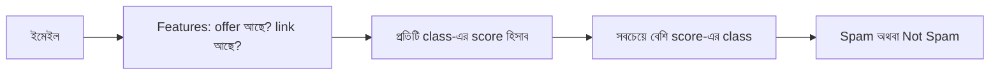
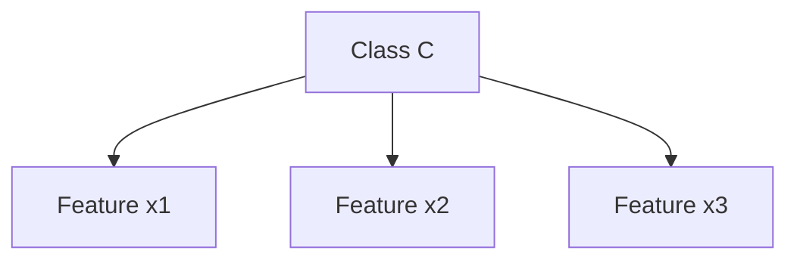

# Naive Bayes — সহজ বাংলা রিভিশন নোট

> **মূল ধারণা:** প্রতিটি class-এর জন্য **আগের সম্ভাবনা × feature-গুলোর সম্ভাবনা** হিসাব করো; যার score বেশি, সেটিই prediction।

## 1. Naive Bayes কী?

**Naive Bayes** হলো Bayes-এর সূত্রভিত্তিক একটি **probabilistic classification algorithm**। এটি features দেখে কোনো sample কোন class-এর হওয়ার সম্ভাবনা বেশি, তা নির্ণয় করে।

উদাহরণ: ইমেইলের শব্দ দেখে **Spam / Not Spam**, অথবা review-এর শব্দ দেখে **Positive / Negative** নির্ধারণ করা।



## 2. Bayes-এর সূত্র: উল্টো দিকের probability বের করা

আমরা training data থেকে জানতে পারি, **Spam হলে “offer” থাকার সম্ভাবনা কত**। কিন্তু prediction-এর সময় দরকার, **“offer” থাকলে Spam হওয়ার সম্ভাবনা কত**। Bayes-এর সূত্র এই দুই দিককে যুক্ত করে।

$$
\boxed{P(C\mid X)=\frac{P(X\mid C)P(C)}{P(X)}}
$$

এখানে $C$ হলো একটি class এবং $X=(x_1,x_2,\ldots,x_n)$ হলো sample-এর feature values।

| অংশ | নাম | সহজ অর্থ |
| --- | --- | --- |
| $P(C)$ | Prior | Features দেখার আগে class-এর সম্ভাবনা |
| $P(X\mid C)$ | Likelihood | Class জানা থাকলে এই features পাওয়ার সম্ভাবনা |
| $P(X)$ | Evidence | সব class মিলিয়ে এই features পাওয়ার সম্ভাবনা |
| $P(C\mid X)$ | Posterior | Features দেখার পরে class-এর সম্ভাবনা |

সব সম্ভাব্য class $c$ নিয়ে:

$$
P(X)=\sum_c P(X\mid c)P(c)
$$

> **মনে রাখো:** $P(C\mid X)$ এবং $P(X\mid C)$ এক জিনিস নয়। “বৃষ্টি হলে রাস্তা ভেজা” আর “রাস্তা ভেজা হলে বৃষ্টি” একই ঘটনা নয়—অন্য কারণেও রাস্তা ভিজতে পারে।

## 3. নামের মধ্যে “Naive” কেন?

একই class জানা থাকলে features-গুলোকে **পরস্পর স্বাধীন (conditionally independent)** ধরা হয়। তাই একটি বড় joint likelihood-কে ছোট ছোট likelihood-এর গুণফল হিসেবে লেখা যায়।

$$
\boxed{P(x_1,x_2,\ldots,x_n\mid C)=\prod_{i=1}^{n}P(x_i\mid C)}
$$



চিত্রের অর্থ: **Class দেওয়া থাকলে** এক feature-এর তথ্য অন্য feature-এর probability বদলায় না—এটাই মডেলের assumption। Features সব পরিস্থিতিতে স্বাধীন, এমন দাবি করা হচ্ছে না।

বাস্তবে “free” ও “offer” একসঙ্গে আসতে পারে; assumption পুরোপুরি সত্য না হলেও মডেলটি অনেক classification সমস্যায় কাজে লাগে।

## 4. Prediction-এর মূল সমীকরণ

Bayes-এর সূত্রে independence assumption বসালে:

$$
P(C\mid X)=\frac{P(C)\prod_{i=1}^{n}P(x_i\mid C)}{\sum_c P(c)\prod_{i=1}^{n}P(x_i\mid c)}
$$

একই sample-এর জন্য denominator সব class-এর ক্ষেত্রে একই। তাই শুধু **কোন class জিতবে** জানতে denominator হিসাব করার দরকার নেই।

$$
\boxed{\hat{C}=\arg\max_c\left[P(c)\prod_{i=1}^{n}P(x_i\mid c)\right]}
$$

**$\arg\max$** মানে: যে class-এর জন্য expression-এর মান সবচেয়ে বড়, সেই **class** বেছে নেওয়া। এই নিয়মকে **Maximum a Posteriori (MAP)** classification বলা হয়।

> **Score ≠ probability:** শুধু prior × likelihood হলো unnormalized score। Posterior probability পেতে প্রতিটি score-কে সব class-এর score-এর যোগফল দিয়ে ভাগ করতে হবে।

## 5. হাতে করা উদাহরণ: ইমেইল Spam কি না?

ধরি, training data-তে ১০টি ইমেইল আছে। দুটি binary feature: **offer শব্দ আছে কি না**, **link আছে কি না**।

| Class | মোট ইমেইল | offer আছে | link আছে |
| --- | ---: | ---: | ---: |
| Spam ($S$) | 4 | 3 | 3 |
| Not Spam ($N$) | 6 | 1 | 2 |

**ধাপ ১ — Prior:**

$$
P(S)=\frac{4}{10}=0.4,\qquad P(N)=\frac{6}{10}=0.6
$$

**ধাপ ২ — Likelihood:**

$$
P(\text{offer}=1\mid S)=\frac34,\qquad P(\text{link}=1\mid S)=\frac34
$$

$$
P(\text{offer}=1\mid N)=\frac16,\qquad P(\text{link}=1\mid N)=\frac26
$$

**ধাপ ৩ — নতুন ইমেইলে offer এবং link দুটোই থাকলে:**

$$
\text{score}(S)=\frac4{10}\times\frac34\times\frac34=\frac9{40}=0.225
$$

$$
\text{score}(N)=\frac6{10}\times\frac16\times\frac26=\frac1{30}\approx0.0333
$$

তাই prediction **Spam**, কারণ $0.225>0.0333$।

**ধাপ ৪ — মডেলের posterior probability চাইলে normalize করি:**

$$
P(S\mid X)=\frac{9/40}{9/40+1/30}=\frac{27}{31}\approx0.871
$$

$$
P(N\mid X)=\frac4{31}\approx0.129
$$

```text
নতুন ইমেইল: offer = 1, link = 1
                     |
             +-------+-------+
             |               |
          Spam            Not Spam
       score 0.225       score 0.0333
             |               |
             +-------+-------+
                     |
              বড় score: Spam
```

উদাহরণটি **smoothing ছাড়া** করা হয়েছে। পরের অংশে zero probability সামলানোর উপায় আছে।

## 6. Zero-frequency সমস্যা ও Laplace smoothing

ধরি, training data-র কোনো Spam ইমেইলে “prize” শব্দ নেই। সাধারণ count দিয়ে হিসাব করলে:

$$
P(\text{prize}=1\mid S)=0
\quad\Rightarrow\quad
\text{score}(S)=P(S)\times\cdots\times0=0
$$

অর্থাৎ অন্য features Spam-এর পক্ষে হলেও একটি zero পুরো গুণফলকে zero করে দেয়। **Smoothing** প্রতিটি সম্ভাব্য outcome-এর count-এ ছোট একটি সংখ্যা $\alpha>0$ যোগ করে।

একটি categorical feature $X_i$-এর $K_i$টি সম্ভাব্য value থাকলে:

$$
\boxed{P(X_i=v\mid c)=\frac{N_{i,v,c}+\alpha}{N_c+\alpha K_i}}
$$

এখানে $N_{i,v,c}$ = class $c$-তে feature $i$-এর value $v$ হওয়ার count, এবং $N_c$ = class $c$-এর মোট sample। Feature value অনুপস্থিত নেই ধরে সূত্রটি লেখা।

- $\alpha=1$ হলে **Laplace smoothing**।
- Binary feature-এর দুটি outcome, তাই denominator $N_c+2\alpha$।
- যেমন, ৪টি Spam-এর মধ্যে “prize” একটিতেও না থাকলে: $(0+1)/(4+2)=1/6$।

> **সতর্কতা:** Text-এর শব্দের frequency নিয়ে কাজ করলে denominator আলাদা হয়; নিচে Multinomial-এর সূত্র দেখো।

## 7. তিনটি প্রচলিত ধরন

| ধরন | Feature-এর ধরন | উদাহরণ |
| --- | --- | --- |
| Bernoulli NB | Binary: 0 বা 1 | শব্দ আছে / নেই |
| Multinomial NB | Count: 0, 1, 2, … | একটি শব্দ কতবার এসেছে |
| Gaussian NB | Continuous numerical value | উচ্চতা, ওজন |

### Bernoulli Naive Bayes — উপস্থিতি ও অনুপস্থিতি দুটোই

যদি $p_{ic}=P(x_i=1\mid c)$ হয়, তবে $x_i\in\{0,1\}$-এর জন্য:

$$
P(x_i\mid c)=p_{ic}^{x_i}(1-p_{ic})^{1-x_i}
$$

অর্থাৎ feature **থাকলে** $p_{ic}$, **না থাকলে** $1-p_{ic}$ ব্যবহার করব। উদাহরণে offer আছে কিন্তু link নেই হলে Spam-এর score হবে $0.4\times0.75\times(1-0.75)=0.075$।

### Multinomial Naive Bayes — শব্দের count

একটি নির্দিষ্ট vocabulary-তে মোট $V$টি ভিন্ন শব্দ থাকলে:

$$
\theta_{wc}=P(w\mid c)=\frac{T_{wc}+\alpha}{T_c+\alpha V}
$$

এখানে $T_{wc}$ = class $c$-এর সব document-এ শব্দ $w$ মোট যতবার এসেছে; $T_c$ = ওই class-এর সব vocabulary শব্দের মোট count।

নতুন document-এ শব্দ $w$ মোট $x_w$ বার থাকলে classification score:

$$
\text{score}(c)=P(c)\prod_{w=1}^{V}\theta_{wc}^{x_w}
$$

শব্দ তিনবার এলে তার likelihood factor তিনবার গুণ হবে। পুরো multinomial likelihood-এর একটি coefficient এখানে বাদ দেওয়া হয়েছে, কারণ একই document-এর জন্য সেটি সব class-এ সমান।

### Gaussian Naive Bayes — সংখ্যার জন্য bell curve

প্রতি class-এ প্রতিটি numerical feature-এর distribution-কে Gaussian বা Normal ধরা হয়:

$$
f(x_i\mid c)=\frac{1}{\sqrt{2\pi\sigma_{ic}^{2}}}
\exp\left(-\frac{(x_i-\mu_{ic})^2}{2\sigma_{ic}^{2}}\right)
$$

এখানে $\mu_{ic}$ = class $c$-তে feature $i$-এর mean এবং $\sigma_{ic}^{2}$ = variance। Training-এ এগুলো estimate করা হয়।

```text
Density
  ^
  |             .-''''-.
  |           .'        '.
  |         .'            '.
  |______.-'________________'-.______> x
                  μ
          কেন্দ্রের কাছে density বেশি
```

এখানে $f$ হলো **probability density**, কোনো নির্দিষ্ট সংখ্যার probability নয়। Gaussian NB-তে এই density-গুলো গুণ করে score তৈরি হয়। Variance zero হলে ছোট positive variance floor দিয়ে হিসাব স্থিতিশীল রাখতে হয়।

## 8. অনেকগুলো ছোট probability গুণ না করে log কেন?

অনেক feature থাকলে গুণফল এত ছোট হতে পারে যে computer সেটিকে zero হিসেবে ধরে ফেলে (**numerical underflow**)। তাই log ব্যবহার করা হয়:

$$
\boxed{\log\text{score}(c)=\log P(c)+\sum_{i=1}^{n}\log P(x_i\mid c)}
$$

Gaussian-এর ক্ষেত্রে $P(x_i\mid c)$-এর জায়গায় density $f(x_i\mid c)$ হবে। Multinomial-এর ক্ষেত্রে যোগফলটি হবে $\sum_w x_w\log\theta_{wc}$।

Log ক্রম বজায় রাখে, তাই সবচেয়ে বড় score এবং সবচেয়ে বড় log-score একই class দেয়। **Log zero সংজ্ঞায়িত নয়**, তাই zero-frequency সমস্যা শুধু log নিলে দূর হয় না; smoothing দরকার।

## 9. Training বনাম prediction


সাধারণ Naive Bayes fit করতে count বা summary statistics estimate করা হয়; gradient descent দিয়ে weight শেখানো সাধারণত লাগে না।

## 10. সুবিধা, সীমাবদ্ধতা ও সাধারণ ভুল

**সুবিধা:** Training ও prediction দ্রুত; অনেক feature থাকা text classification-এ একটি উপযোগী baseline।

**সীমাবদ্ধতা:** Features খুব সম্পর্কিত হলে একই evidence একাধিকবার গণনা হতে পারে। ফলে prediction ঠিক হলেও posterior probability অতিরিক্ত আত্মবিশ্বাসী হতে পারে। Gaussian NB-তে distribution-এর assumption-ও ফলকে প্রভাবিত করে।

রিভিশনের সময় এই ভুলগুলো খেয়াল রাখো:

- $P(c\mid X)$ ও $P(X\mid c)$ উল্টে ফেলো না।
- Conditional independence মানে **class দেওয়া থাকলে** independence।
- শুধু likelihood নয়, **prior-ও** score-এ গুণ করতে হবে।
- Bernoulli-তে feature না থাকলেও তার $1-p$ factor থাকে।
- Multinomial-এর denominator-এ **মোট শব্দের count**, মোট document-এর সংখ্যা নয়।
- Unnormalized score-কে সরাসরি posterior probability বলো না।

## 11. এক মিনিটের রিভিশন

| মনে রাখার বিষয় | সূত্র / উত্তর |
| --- | --- |
| Bayes | $P(c\mid X)=P(X\mid c)P(c)/P(X)$ |
| Naive assumption | $P(X\mid c)=\prod_i P(x_i\mid c)$ |
| Class prior | $P(c)=N_c/N$; $N$ = মোট training sample |
| Prediction | $\hat c=\arg\max_c P(c)\prod_iP(x_i\mid c)$ |
| Posterior | $\text{score}(c)/\sum_k\text{score}(k)$ |
| Log-score | $\log P(c)+\sum_i\log P(x_i\mid c)$ |
| Zero-frequency সমাধান | Smoothing; Laplace হলে $\alpha=1$ |
| কোন ধরন কখন? | Binary → Bernoulli; Count → Multinomial; Continuous → Gaussian |

**মনে রাখার লাইন:** আগে **Prior**, তারপর প্রতি feature-এর **Likelihood**, শেষে সবচেয়ে বড় **Score**।
