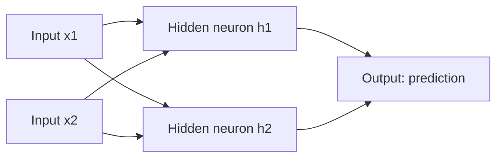
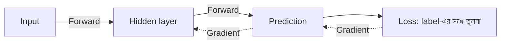
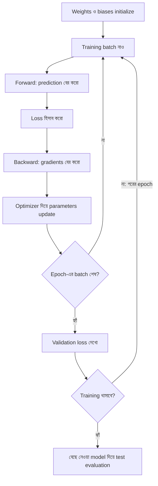

# Neural Network (NN) — সহজ বাংলা রিভিশন নোট

> **মূল ধারণা:** Input থেকে prediction করো → ভুল মাপো → কোন weight ভুলের জন্য কতটা দায়ী বের করো → weights ও biases আপডেট করো।

## 1. Neural Network কী?

**Neural Network** হলো অনেকগুলো neuron বা গণনা করার unit দিয়ে তৈরি একটি মডেল। প্রতিটি neuron input-এর weighted sum বের করে, bias যোগ করে এবং activation function প্রয়োগ করে। Training-এর সময় **weights ও biases শেখা হয়**।

এখানে মূলত **fully connected feedforward network বা Multilayer Perceptron (MLP)** আলোচনা করা হয়েছে। Feedforward মানে prediction-এর সময় তথ্য input থেকে output-এর দিকে যায়।



- **Input layer:** Features গ্রহণ করে।
- **Hidden layer:** Features থেকে intermediate representation শেখে।
- **Output layer:** চূড়ান্ত prediction দেয়।

উপরের network-টি **2 → 2 → 1**: দুটি input, একটি hidden layer-এ দুটি neuron, একটি output neuron। প্রচলিত layer গণনায় input বাদ দিলে এটি দুই layer-এর network।

## 2. একটি neuron-এর সমীকরণ

$$
\boxed{z=\sum_{i=1}^{n}w_i x_i+b,\qquad a=g(z)}
$$

| চিহ্ন | অর্থ |
| --- | --- |
| $x_i$ | Input feature |
| $w_i$ | Feature-এর weight; output-এ প্রভাব নিয়ন্ত্রণ করে |
| $b$ | Bias; input zero হলেও offset দিতে পারে |
| $z$ | Activation-এর আগের weighted sum |
| $g$ | Activation function |
| $a$ | Neuron-এর output বা activation |

```text
 x1 ── ×w1 ──┐
 x2 ── ×w2 ──┼──> যোগফল + b ──> z ──> g(z) ──> a
 x3 ── ×w3 ──┘
```

**উদাহরণ:** $x_1=1$, $x_2=2$, $w_1=0.5$, $w_2=-1$, $b=1$ হলে $z=0.5(1)-1(2)+1=-0.5$। ReLU ব্যবহার করলে output $a=\max(0,-0.5)=0$।

## 3. Activation function কেন দরকার?

পরপর শুধু linear/affine transformation বসালে সব মিলিয়ে আবার একটি affine transformation-ই হয়:

$$
W_2(W_1x+b_1)+b_2=(W_2W_1)x+(W_2b_1+b_2)
$$

তাই hidden layer-এ **nonlinear activation** না থাকলে শুধু layer বাড়িয়ে nonlinear সম্পর্ক শেখা যায় না। যেমন XOR-এর জন্য একটি linear decision boundary যথেষ্ট নয়।

| $x_1$ | $x_2$ | XOR output |
| ---: | ---: | ---: |
| 0 | 0 | 0 |
| 0 | 1 | 1 |
| 1 | 0 | 1 |
| 1 | 1 | 0 |

### গুরুত্বপূর্ণ activation ও derivative

| নাম | সমীকরণ | Derivative | মনে রাখো |
| --- | --- | --- | --- |
| Sigmoid | $\sigma(z)=1/(1+e^{-z})$ | $\sigma(z)(1-\sigma(z))$ | Output 0 থেকে 1-এর মধ্যে |
| Tanh | $\tanh(z)$ | $1-\tanh^2(z)$ | Output −1 থেকে 1-এর মধ্যে |
| ReLU | $\max(0,z)$ | $z>0$ হলে 1; $z<0$ হলে 0 | Negative input-এ output zero |
| Linear | $g(z)=z$ | $1$ | Unbounded regression output-এ ব্যবহার হয় |

ReLU-এর $z=0$ বিন্দুতে derivative সংজ্ঞায়িত নয়; implementation-এ সাধারণত 0 নেওয়া হয়।

```text
ReLU: a = max(0, z)

 a
 ^           /
 |          /
 |         /
 |        /
 +-------/------------> z
         0
 z ≤ 0 হলে a = 0
```

## 4. Forward propagation: layer ধরে prediction

ধরি, $a^{[0]}=x$ এবং network-এ $L$টি layer আছে, input layer বাদ দিয়ে। Layer $l$-এর জন্য:

$$
\boxed{z^{[l]}=W^{[l]}a^{[l-1]}+b^{[l]}}
$$

$$
\boxed{a^{[l]}=g^{[l]}(z^{[l]}),\qquad \hat y=a^{[L]}}
$$

এখানে **$[l]$ হলো layer-এর index, power নয়**। একটি sample-কে column vector ধরলে:

| পরিমাণ | Shape |
| --- | --- |
| $a^{[l-1]}$ | $n_{l-1}\times1$ |
| $W^{[l]}$ | $n_l\times n_{l-1}$ |
| $b^{[l]}$, $z^{[l]}$, $a^{[l]}$ | $n_l\times1$ |

এখানে $n_l$ হলো layer $l$-এর neuron সংখ্যা। Shapes মিলিয়ে দেখলে matrix multiplication-এর ভুল সহজে ধরা যায়।

## 5. Output activation ও loss বাছাই

**Loss** একটি sample-এর prediction কতটা ভুল তা মাপে। **Cost/objective** সাধারণত training sample-গুলোর গড় loss, প্রয়োজনে regularization-সহ। নিচে $m$ = sample সংখ্যা।

| কাজ | প্রচলিত output activation | প্রচলিত loss |
| --- | --- | --- |
| Unbounded scalar regression | Linear | Mean Squared Error |
| Binary classification | Sigmoid | Binary Cross-Entropy |
| একটিমাত্র class সঠিক, মোট $K$টি class | Softmax | Categorical Cross-Entropy |

**Regression — Mean Squared Error (MSE):**

$$
J=\frac1m\sum_{r=1}^{m}(\hat y_r-y_r)^2
$$

কিছু বইয়ে সুবিধার জন্য সামনে $1/2$ থাকে; সে ক্ষেত্রে derivative-এ 2 factor থাকে না।

**Binary classification — Binary Cross-Entropy (BCE):**

$$
\ell=-\left[y\log\hat y+(1-y)\log(1-\hat y)\right],\qquad
J=\frac1m\sum_{r=1}^{m}\ell_r
$$

যদি $y=1$, তাহলে $\ell=-\log\hat y$: সঠিক class-এর probability বাড়লে loss কমে। এখানে log হলো natural log।

**Multiclass — Softmax ও Cross-Entropy:**

$$
\hat y_k=\frac{e^{z_k}}{\sum_{j=1}^{K}e^{z_j}},\qquad
\ell=-\sum_{k=1}^{K}y_k\log\hat y_k
$$

এখানে $y$ হলো one-hot label এবং $\sum_k\hat y_k=1$। একটি sample-এর একাধিক label একসঙ্গে সঠিক হতে পারলে সাধারণত প্রতি label-এ sigmoid ও BCE ব্যবহার করা হয়।

## 6. Backpropagation: ভুলের প্রভাব উল্টো দিকে বের করা

**Backpropagation** chain rule ব্যবহার করে loss-এর সাপেক্ষে প্রতিটি weight ও bias-এর **gradient** বের করে। Gradient বলে, কোনো parameter সামান্য বদলালে loss কোন দিকে কত দ্রুত বদলাবে।



একটি weight থেকে loss পর্যন্ত পথ ধরো:

$$
w\longrightarrow z\longrightarrow a\longrightarrow\ell
$$

তাহলে chain rule:

$$
\boxed{\frac{\partial\ell}{\partial w}
=\frac{\partial\ell}{\partial a}
\frac{\partial a}{\partial z}
\frac{\partial z}{\partial w}}
$$

### Layer ধরে gradient-এর সূত্র

নিচের সূত্রগুলো **একটি sample-এর loss** $\ell$-এর জন্য। ধরি:

$$
\delta^{[l]}=\frac{\partial\ell}{\partial z^{[l]}}
$$

**Sigmoid output + BCE** হলে derivative সরল হয়ে যায়:

$$
\boxed{\delta^{[L]}=\hat y-y}
$$

One-hot label-এর **Softmax + Cross-Entropy** জোড়াতেও vector আকারে $\delta^{[L]}=\hat y-y$। এটি সব activation/loss-এর জন্য সাধারণ সূত্র নয়।

Hidden layer-এর জন্য:

$$
\boxed{\delta^{[l]}=
\left((W^{[l+1]})^T\delta^{[l+1]}\right)
\odot g'^{[l]}(z^{[l]})}
$$

এখানে $\odot$ মানে corresponding element-গুলোর গুণ। তারপর:

$$
\boxed{\frac{\partial\ell}{\partial W^{[l]}}
=\delta^{[l]}(a^{[l-1]})^T,\qquad
\frac{\partial\ell}{\partial b^{[l]}}=\delta^{[l]}}
$$

Batch-এর গড় loss ব্যবহার করলে sample-গুলোর gradient-এর **গড়** নিতে হবে।

## 7. Gradient descent: parameter আপডেট করা

সব weights ও biases একসঙ্গে $\theta$ দিয়ে বোঝালে:

$$
\boxed{\theta_{\text{new}}=\theta_{\text{old}}-\eta\nabla_\theta J}
$$

এখানে $\eta>0$ হলো **learning rate** বা প্রতি update-এর step size। Gradient loss বাড়ার স্থানীয় দিক দেখায়; তাই loss কমানোর জন্য সেটি **বিয়োগ** করা হয়।

```text
Loss J
  ^
  |  ● শুরুর অবস্থান
  |   ↘
  |     ●
  |      ↘
  |        ●___●___/
  +----------------------> parameter θ
          ছোট ছোট update
```

এটি বোঝানোর জন্য একটি সরল curve; neural network-এর বাস্তব loss surface অনেক জটিল হতে পারে।

- Learning rate **খুব ছোট** হলে শেখা ধীর হয়।
- **খুব বড়** হলে ভালো অবস্থান পেরিয়ে যেতে পারে; loss বাড়তে বা ওঠানামা করতে পারে।
- **Backpropagation gradient বের করে**, আর **optimizer সেই gradient দিয়ে parameter আপডেট করে**।

## 8. হাতে করা উদাহরণ: 2 → 2 → 1 network

একটি sample নিই: $x=(1,2)^T$, সত্য label $y=1$। Hidden layer-এ ReLU, output-এ sigmoid এবং loss হিসেবে BCE ব্যবহার করব।

শুরুর parameters:

$$
W^{[1]}=\begin{bmatrix}1&0.5\\-1&1\end{bmatrix},\quad
b^{[1]}=\begin{bmatrix}0\\0\end{bmatrix},\quad
W^{[2]}=\begin{bmatrix}0.5&-1\end{bmatrix},\quad b^{[2]}=0
$$

**ধাপ ১ — Forward:**

$$
z^{[1]}=\begin{bmatrix}1(1)+0.5(2)\\-1(1)+1(2)\end{bmatrix}
=\begin{bmatrix}2\\1\end{bmatrix}
\quad\Rightarrow\quad
a^{[1]}=\begin{bmatrix}2\\1\end{bmatrix}
$$

$$
z^{[2]}=0.5(2)-1(1)=0,\qquad \hat y=\sigma(0)=0.5
$$

**ধাপ ২ — Loss:**

$$
\ell=-\log(0.5)\approx0.6931
$$

**ধাপ ৩ — Output layer-এর gradient:**

$$
\delta^{[2]}=\hat y-y=0.5-1=-0.5
$$

$$
\frac{\partial\ell}{\partial W^{[2]}}
=-0.5\begin{bmatrix}2&1\end{bmatrix}
=\begin{bmatrix}-1&-0.5\end{bmatrix},\qquad
\frac{\partial\ell}{\partial b^{[2]}}=-0.5
$$

**ধাপ ৪ — Hidden layer-এর gradient:** দুই hidden neuron-এর $z>0$, তাই দুই ক্ষেত্রেই ReLU derivative 1।

$$
\delta^{[1]}=\begin{bmatrix}0.5\\-1\end{bmatrix}(-0.5)
\odot\begin{bmatrix}1\\1\end{bmatrix}
=\begin{bmatrix}-0.25\\0.5\end{bmatrix}
$$

$$
\frac{\partial\ell}{\partial W^{[1]}}
=\begin{bmatrix}-0.25\\0.5\end{bmatrix}\begin{bmatrix}1&2\end{bmatrix}
=\begin{bmatrix}-0.25&-0.5\\0.5&1\end{bmatrix},\qquad
\frac{\partial\ell}{\partial b^{[1]}}=\begin{bmatrix}-0.25\\0.5\end{bmatrix}
$$

**ধাপ ৫ — Learning rate $\eta=0.1$ নিয়ে সব parameter আপডেট:**

$$
W^{[1]}_{\text{new}}=\begin{bmatrix}1.025&0.55\\-1.05&0.9\end{bmatrix},\quad
b^{[1]}_{\text{new}}=\begin{bmatrix}0.025\\-0.05\end{bmatrix}
$$

$$
W^{[2]}_{\text{new}}=\begin{bmatrix}0.6&-0.95\end{bmatrix},\qquad
b^{[2]}_{\text{new}}=0.05
$$

**ধাপ ৬ — আবার forward করে যাচাই:**

$$
a^{[1]}_{\text{new}}=\begin{bmatrix}2.15\\0.7\end{bmatrix},\qquad
z^{[2]}_{\text{new}}=0.6(2.15)-0.95(0.7)+0.05=0.675
$$

$$
\hat y_{\text{new}}=\sigma(0.675)\approx0.6626,\qquad
\ell_{\text{new}}=-\log(0.6626)\approx0.4116
$$

এখানে সঠিক label $1$-এর probability **0.5 থেকে 0.6626 হয়েছে**, আর loss **0.6931 থেকে 0.4116 হয়েছে**। একটি update কীভাবে prediction উন্নত করতে পারে, এটি তার উদাহরণ; সব step-এ loss কমার নিশ্চয়তা নেই।

> **হিসাবের নিয়ম:** একই forward pass-এর parameters দিয়ে সব gradient বের করো, তারপর update করো। Output weights আগে বদলে সেই নতুন weights দিয়ে hidden gradient বের করলে উপরের backpropagation হিসাব মিলবে না।

## 9. Epoch, batch ও iteration

| শব্দ | সহজ অর্থ |
| --- | --- |
| Epoch | পুরো training dataset একবার ব্যবহার করা |
| Batch | এক update-এর gradient বের করতে নেওয়া sample-এর দল |
| Iteration / Step | একটি parameter update |
| Batch gradient descent | পুরো training set দিয়ে প্রতি update |
| Stochastic gradient descent (এক-sample অর্থে) | একটি sample দিয়ে প্রতি update |
| Mini-batch gradient descent | ছোট একটি batch দিয়ে প্রতি update |

যেমন, ১০০০ sample এবং batch size ১০০ হলে **১ epoch = ১০টি update**। শেষের অসম্পূর্ণ batch-ও ব্যবহার করলে সাধারণভাবে প্রতি epoch-এ update সংখ্যা $\lceil m/B\rceil$, যেখানে $B$ = batch size।



## 10. Parameter সংখ্যা কীভাবে বের করবে?

একটি fully connected layer-এ $n_{\text{in}}$টি input এবং $n_{\text{out}}$টি neuron থাকলে, প্রতি neuron-এর একটি bias ধরে:

$$
\boxed{\text{Parameters}=n_{\text{in}}n_{\text{out}}+n_{\text{out}}}
$$

আমাদের **2 → 2 → 1** network-এ:

$$
(2\times2+2)+(2\times1+1)=6+3=\boxed{9}
$$

Input layer-এর নিজের trainable weights নেই; পরের layer-এর সঙ্গে সংযোগগুলোতে weights থাকে।

## 11. Overfitting ও training-এর সাধারণ সমস্যা

**Overfitting:** Training data-তে loss কম, কিন্তু নতুন data-তে ভালো কাজ করে না। Validation loss বাড়তে থাকলেও training loss কমতে থাকলে এটি একটি সম্ভাব্য লক্ষণ।

| সমস্যা / ধারণা | কী মনে রাখবে |
| --- | --- |
| Train / Validation / Test | Train দিয়ে parameters শেখাই; validation দিয়ে settings ও checkpoint বাছি; test দিয়ে চূড়ান্ত মূল্যায়ন করি |
| Feature scaling | Input scale কাছাকাছি হলে optimization সহজ হতে পারে; scaler শুধু training data-তে fit করো |
| Initialization | একই hidden layer-এর সব weights zero দিয়ে শুরু করলে symmetry ভাঙে না; উপযুক্ত random initialization ব্যবহার করো |
| Vanishing gradient | Backward যেতে যেতে gradient ছোট হয়ে আগের layers-এর শেখা ধীর হতে পারে; sigmoid/tanh-এর saturation একটি কারণ |
| Exploding gradient | Gradient খুব বড় হলে update অস্থিতিশীল হতে পারে; gradient clipping সাহায্য করতে পারে |
| Early stopping | Validation ফল দেখে training থামিয়ে ভালো checkpoint নেওয়া |
| Dropout | Training-এ কিছু activation randomভাবে বাদ দিয়ে regularization করা |
| L2 regularization | বড় weights-কে penalty দিয়ে জটিলতা নিয়ন্ত্রণ করা |

L2 penalty-সহ একটি প্রচলিত objective, যেখানে $J_{\text{data}}$ হলো গড় data loss:

$$
J=J_{\text{data}}+\frac\lambda2\sum_{l=1}^{L}\|W^{[l]}\|_F^2
$$

এখানে $\lambda\ge0$ penalty-এর শক্তি নিয়ন্ত্রণ করে; $\|W\|_F^2$ মানে matrix-এর সব weight-এর square-এর যোগফল। এই convention-এ weight gradient-এ $\lambda W$ যোগ হয়; biases-কে এখানে penalty দেওয়া হয়নি।

## 12. সাধারণ ভুল

- **Bias বাদ দেওয়া:** Bias-ও trainable parameter; এর gradient ও update আছে।
- **Loss ও accuracy এক মনে করা:** Loss probability-এর মানও বিবেচনা করে; accuracy শুধু class ঠিক কি না গোনে।
- **সব জায়গায় $\hat y-y$ ব্যবহার করা:** এই output derivative নির্দিষ্ট activation–loss জোড়ার জন্য সরল হয়।
- **Batch gradient যোগ করে average ভুলে যাওয়া:** গড় loss-এর gradient-ও গড় হতে হবে।
- **Test set দেখে বারবার model বদলানো:** এতে চূড়ান্ত evaluation-এর নির্ভরযোগ্যতা কমে।
- **Hidden weights সব zero দিয়ে শুরু করা:** একই neurons একইভাবে শিখতে থাকে; আলাদা features শেখার সুযোগ কমে।

## 13. এক মিনিটের রিভিশন

| মনে রাখার বিষয় | সূত্র / উত্তর |
| --- | --- |
| Neuron | $z=\sum_iw_ix_i+b$, তারপর $a=g(z)$ |
| Forward | $z^{[l]}=W^{[l]}a^{[l-1]}+b^{[l]}$ |
| Nonlinearity কেন? | একাধিক affine layer মিলে আবার affine-ই হয় |
| Sigmoid + BCE output error | $\delta^{[L]}=\hat y-y$ |
| Hidden error | পরের layer-এর error পিছিয়ে এনে activation derivative দিয়ে গুণ |
| Weight gradient | $\delta^{[l]}(a^{[l-1]})^T$ — একটি sample-এর জন্য |
| Update | $\theta\leftarrow\theta-\eta\nabla_\theta J$ |
| Trainable parameters | Weights ও biases |
| Hyperparameters | Learning rate, layer সংখ্যা, neuron সংখ্যা, batch size ইত্যাদি |
| Layer-এর parameter সংখ্যা | $(n_{\text{in}}+1)n_{\text{out}}$ |

**মনে রাখার লাইন:** **Forward → Loss → Backward → Update → Repeat**।

**আরও বিস্তারিত:** [Gradient Descent ও optimizers](../Gradient%20Descent/README.md) · [Evaluation Metrics](../Evaluation%20Metrics/README.md) · [Softmax / Multinomial Regression](../Multinomial%20Regression/README.md)
